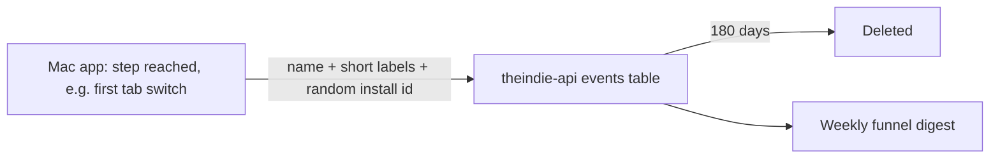

# Fast Tab (Mac) — usage data label and policy text

What the Mac app discloses about the usage events it sends (since `feat/telemetry`, 2026-11-19).
Keep in step with `Sources/FastTab/Resources/PrivacyInfo.xcprivacy` (the same answers,
machine-readable, copied into `FastTab.app/Contents/Resources`) and with the public policy at
https://theindie.app/fasttab/privacy (source: `theindieapp_website` `src/pages/fasttab/privacy.astro`).

The iPhone companion (`ios/FastTabMobile`) sends no usage events; its App Store label
(`marketing/appstore/app-privacy.json`) is unchanged.

## Usage data

The Mac app sends anonymous funnel events (`FastTabTelemetry`, registry `telemetry/funnels.yaml`)
to theindie-api `POST /v1/events`. Always on, no opt-out (owner decision 2026-11-16), disclosed here.

| Sent | Never sent |
| --- | --- |
| Event name (`uf_Onboard_02_FirstTabSwitch`) | Tab titles, URLs, bookmarks, history, search text |
| Short labels: where an upsell was (`trial_banner`), license tier, browser app name, build channel | License key, email, name, Polar ids |
| Random install id made only for this (not the license, feedback or sync one) | iCloud or Apple ID |
| App version, macOS, plan (free / trial / paid) | IP address (the server never stores it) |
| Time, rounded (server keeps the hour, device time to the minute) | Anything for advertising or tracking |

## App Privacy answers (if the Mac app ever ships on the App Store)

Fast Tab for Mac is a direct download today, so there is no App Store label to update. The
privacy manifest already carries these answers:

| Question | Answer |
| --- | --- |
| Data type | **Usage Data › Product Interaction** |
| Linked to the user's identity? | **No** ("Data Not Linked to You") |
| Used for tracking? | **No** |
| Purpose | **Analytics** |

## Policy text to add (website, owner approves)

The "How data is handled" section of the Fast Tab privacy page currently says "Product usage inside
the FastTab app is separate from website analytics." That stays true (no Google Analytics in the
app), but the page says nothing about the app's own usage events. Add this paragraph after it:

> **Usage statistics**
> To learn where people get stuck, the Mac app sends us anonymous usage events: which step was
> reached (for example "first tab switch" or "opened the pricing page"), the app version, and
> whether you are on the trial, the free plan or a paid license. They carry a random number made
> only for these statistics, never your tabs, URLs, bookmarks, history, license key or IP address,
> so we cannot tell who sent them. We keep them for 180 days.

The "No account data" card ("does not require an account, profile, advertising identifier…") stays true.
